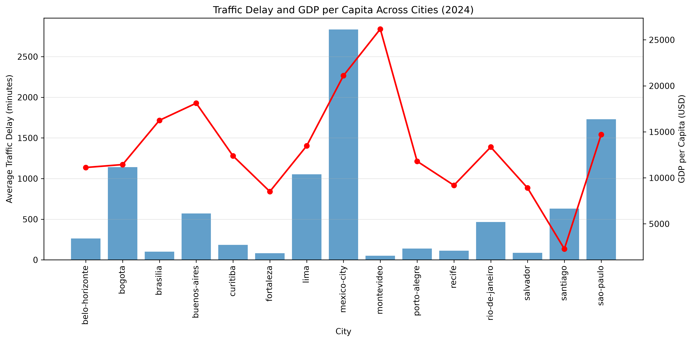
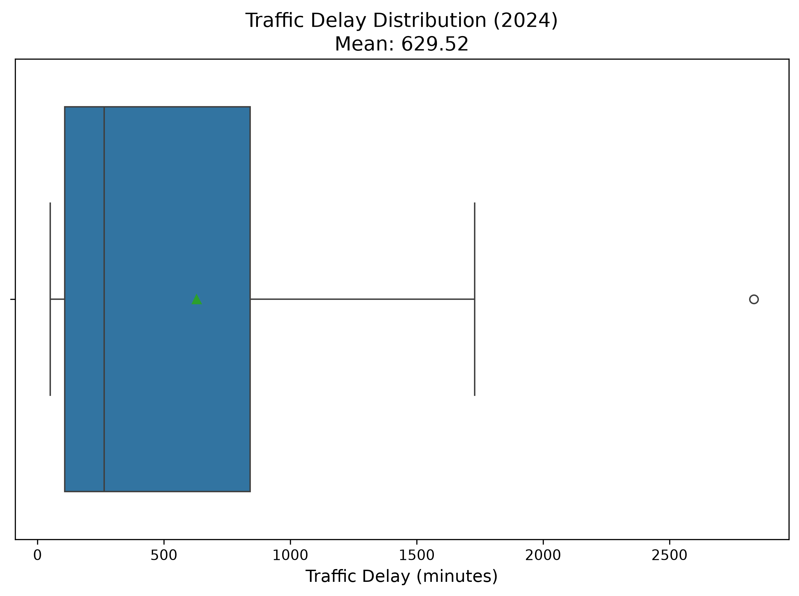
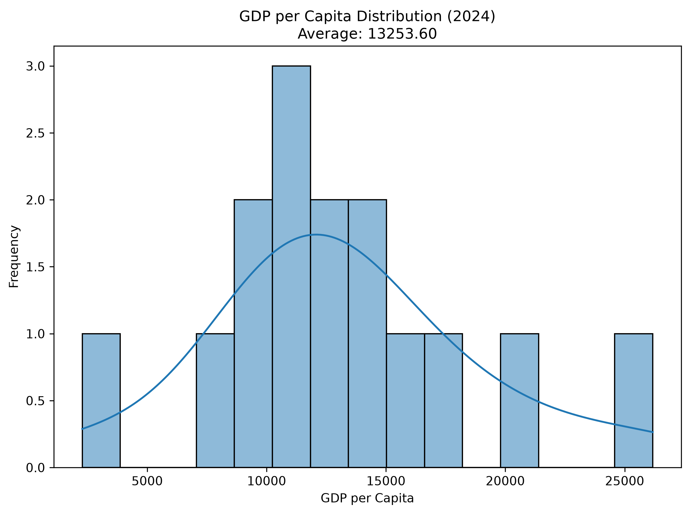
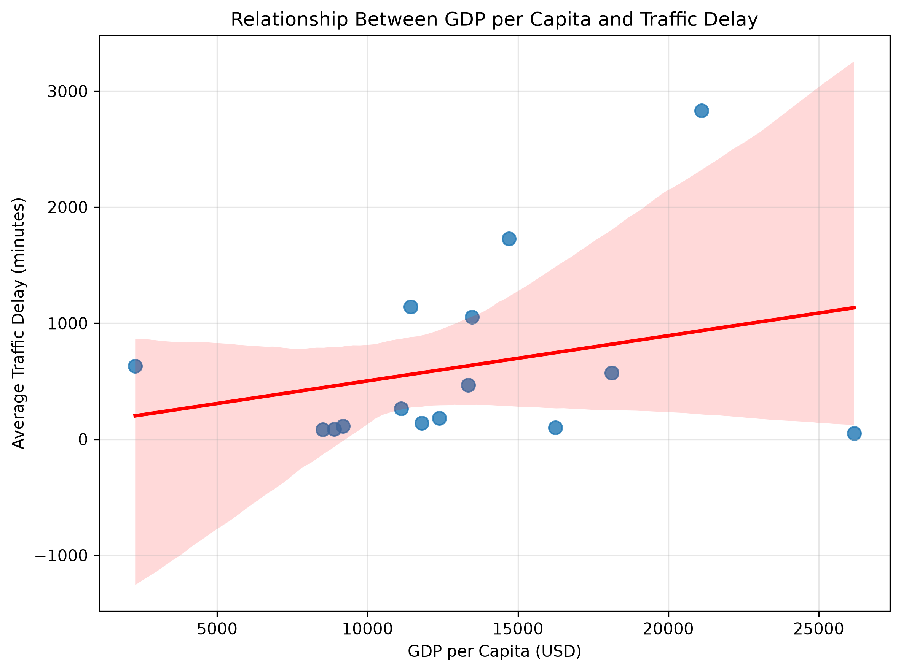

# 🚦 Urban Mobility and Economic Performance Analysis

Exploratory Data Analysis using TomTom Traffic Index and OECD economic indicators to investigate the relationship between traffic congestion and city-level economic performance.



---

## Project Overview

This project analyzes the relationship between urban mobility and economic performance across Latin American cities using traffic congestion data from the TomTom Traffic Index and economic indicators from the OECD.

The objective is to identify patterns that may support decision-making related to transportation planning and urban development through data cleaning, integration, visualization, and exploratory analysis.

---

## Table of Contents

- [Business Question](#business-question)
- [Business Answer](#business-answer)
- [Technologies Used](#technologies-used)
- [Dataset](#dataset)
- [Project Workflow](#project-workflow)
- [Methodology](#methodology)
- [Key Findings](#key-findings)
- [Project Visualizations](#project-visualizations)
- [Project Limitations](#project-limitations)
- [Skills Demonstrated](#skills-demonstrated)
- [Repository Structure](#repository-structure)
- [How to Run the Project](#how-to-run-the-project)
- [Future Improvements](#future-improvements)
- [Acknowledgements](#acknowledgements)
- [Author](#author)

---

## Business Question

**Which city—Bogotá, Lima, Buenos Aires, or another major city—shows the strongest combination of high traffic congestion and relatively low economic productivity, suggesting it should be prioritized for transportation infrastructure investment?**

---

## Business Answer

Based on the exploratory analysis, **Bogotá** emerged as the strongest candidate among the analyzed cities. It combines relatively high traffic congestion with lower GDP per capita compared with Lima and Buenos Aires.

Although the Pearson correlation coefficient (**0.283**) indicates only a weak positive linear relationship between congestion and GDP per capita, Bogotá represents a relevant case for future transportation investment studies. Additional variables such as public transportation quality, urban expansion, and population growth should be incorporated before making policy decisions.

---

## Technologies Used

| Category | Tools |
|---|---|
| Programming | Python |
| Data Analysis | Pandas, NumPy |
| Data Visualization | Matplotlib, Seaborn |
| Development Environment | JupyterLab, Visual Studio Code |

---

## Dataset

The analysis combines two publicly available datasets:

- **TomTom Traffic Index:** urban mobility indicators, including traffic delay, traffic index, travel time, and congestion-related measures.
- **OECD Metropolitan Database:** economic and demographic indicators, including GDP per capita, unemployment, and population.

The datasets were standardized, aggregated by city and year, and integrated using an **INNER JOIN**.

---

## Project Workflow

The analysis followed a structured data analytics workflow:

1. Data loading from TomTom Traffic Index and OECD datasets.
2. Data cleaning and standardization of column names, dates, and numeric variables.
3. Data aggregation by city and year.
4. Integration of traffic and economic datasets using an INNER JOIN.
5. Exploratory data analysis through summary statistics and visualizations.
6. Correlation analysis between traffic congestion and GDP per capita.
7. Business interpretation and recommendations based on the findings.

---

## Methodology

The project followed a standard Exploratory Data Analysis (EDA) process:

- Data acquisition from public sources.
- Data quality assessment.
- Data cleaning and preprocessing.
- Feature selection.
- Dataset integration.
- Exploratory visualization.
- Statistical analysis using Pearson correlation.
- Business interpretation of the results.

---

## Key Findings

- Mexico City presented the highest average traffic delay among the analyzed cities.
- The Pearson correlation coefficient between GDP per capita and traffic delay was **0.283**, indicating a weak positive linear relationship.
- Cities with high congestion do not necessarily exhibit higher or lower economic performance.
- Bogotá emerged as a representative case of high congestion combined with relatively lower economic productivity compared with Lima and Buenos Aires.

---

## Project Visualizations

### Traffic Delay Distribution



---

### GDP per Capita Distribution



---

### Traffic Delay vs GDP per Capita


---

### Correlation Analysis



---

## Project Limitations

This analysis has several limitations:

- Only 2024 data were analyzed.
- The study focuses on correlation rather than causation.
- Additional socioeconomic variables could improve the analysis.
- Traffic conditions may be influenced by factors not included in the datasets.

---

## Skills Demonstrated

Throughout this project, the following data analytics skills were applied:

- Data cleaning and preprocessing
- Data aggregation
- Data integration using INNER JOIN
- Exploratory Data Analysis (EDA)
- Data visualization
- Correlation analysis
- Business storytelling
- Insight generation

---

## Repository Structure

```text
mobility-economic-analysis/
│
├── DATA/
├── IMAGES/
├── NOTEBOOKS/
├── ORIGINAL/
├── RESULTS/
├── WORKING/
└── README.md
```

---

## How to Run the Project

1. Clone or download this repository.
2. Install the required Python libraries.
3. Open the final notebook located in the `NOTEBOOKS` folder.
4. Run all notebook cells sequentially.

Required libraries:

- pandas
- numpy
- matplotlib
- seaborn

---

## Future Improvements

- Include additional socioeconomic variables.
- Apply multivariate regression models.
- Develop predictive models for traffic congestion.
- Build an interactive dashboard using Power BI or Tableau.

---

## Acknowledgements

This project uses publicly available datasets from:

- TomTom Traffic Index
- OECD Metropolitan Database

These datasets were used exclusively for educational and portfolio purposes.

---

## Author

**Roberto Blanco Lugo**

Data Analyst | Learning & Development | Business Analytics

- LinkedIn: *linkedin.com/in/roberto-blanco-lugo-/*
- GitHub: *github.com/robertwhitelugo*

